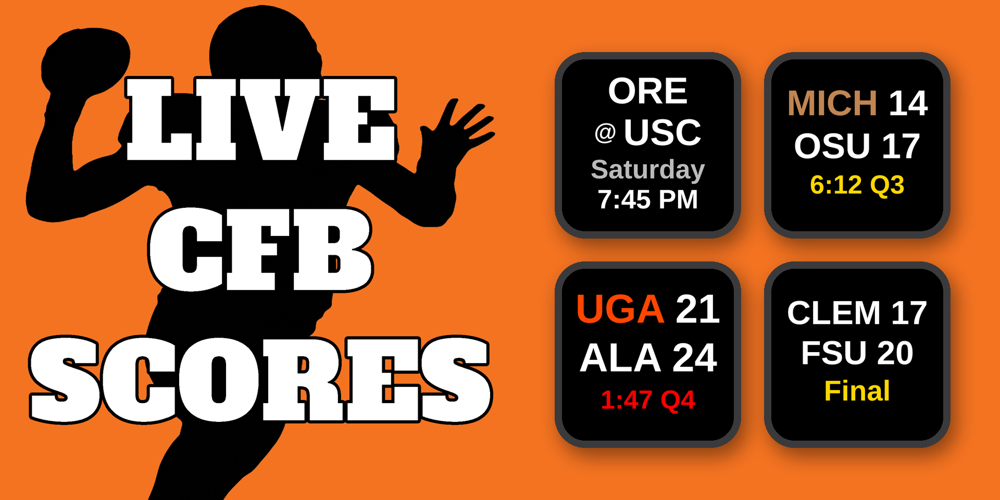
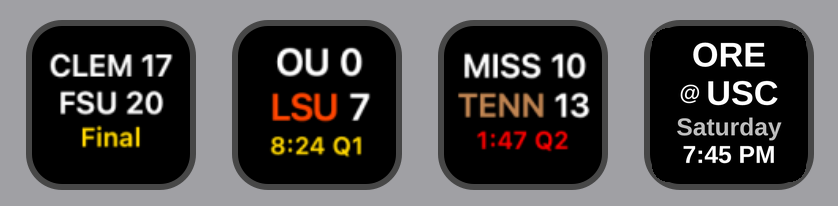
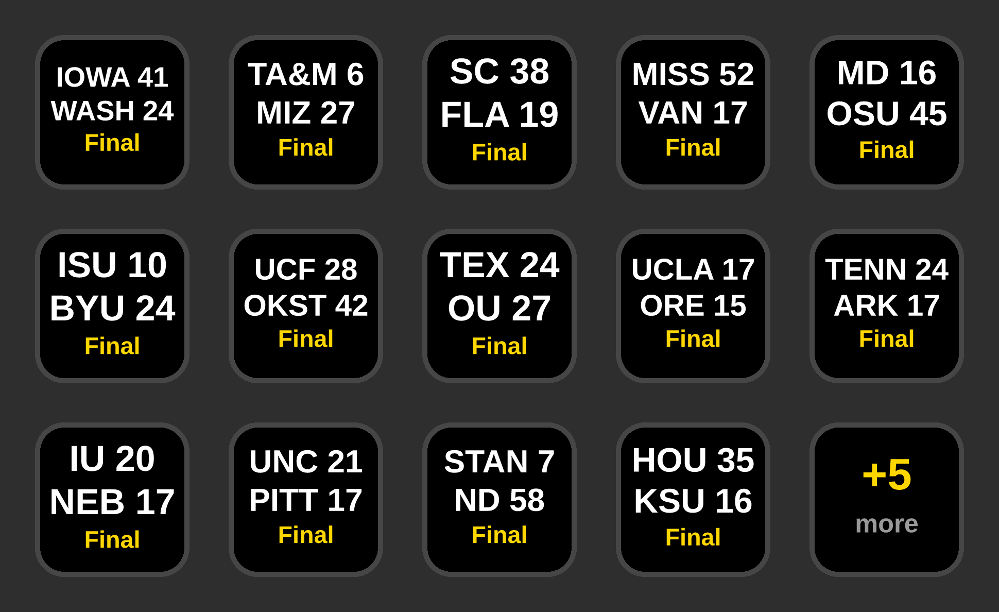
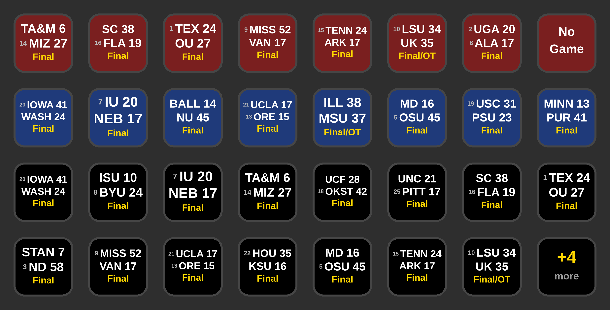

# Live CFB Scores — Stream Deck Plugin



A Stream Deck plugin that shows live college football scores directly on your keys. Two actions: **Live CFB Scores** tracks one FBS team per key, and **Live CFB Scoreboard** fills your keys with this week's Top 25, a conference, or all of FBS. Keys update automatically every 30 seconds.

  [](https://marketplace.elgato.com/product/live-cfb-scores-62e13b96-083e-4ed7-9cc6-78560a6f648c)

---

## Features

- **Live scores** — shows away score, home score, quarter, and game clock while a game is in progress
- **Possession indicator** — the team with the ball is shown in brown, turning orange if they're in the red zone
- **Two-minute timeout** — the clock turns red during the final 2:00 of the 2nd and 4th quarters
- **Pre-game** — shows the matchup (e.g. `MRSH @ UGA`) and scheduled kickoff day/time ("TBD" until the network sets it)
- **Final scores** — shows the final score with a "Final" label, including OT/2OT labeling for overtime games
- **Score-change flash** — when a team scores, the key blinks in that team's primary color, then shows a short card with the team and the play (e.g. KC / TD +6, then XP +1 when the kick is good)
- **End-of-game fireworks** — a short celebratory animation in the winning team's colors plays when the game ends
- **Gamecast shortcut** — press any key to open that game directly in ESPN Gamecast (the box score once the game is final), or a custom link of your choice (e.g. your regional sports network) once the game actually starts
- **Off-week shortcut** — if your team has no game scheduled, pressing the key opens that team's full schedule on ESPN instead
- **No-flicker updates** — keys only redraw when the display actually changes
- **Multi-key support** — add as many team keys as you want, each refreshes independently
- **Custom background color** — set a per-key background color and opacity in the settings panel, handy for telling teams apart at a glance across multiple keys
- **Live CFB Scoreboard action** — a second action that lays out the week: pick the Top 25, any FBS conference, or all of FBS, and each key becomes one game, in kickoff order or by ranking. Different pages can show different boards (SEC on one, Big Ten on another), and each board can have its own background color
- **All 136 FBS teams** across all 11 conferences (SEC, Big Ten, ACC, Big 12, American, Mountain West, Conference USA, MAC, Sun Belt, Pac-12, and Independents)

---

## Recent Updates

**v1.1.0.0**
- New: **Live CFB Scoreboard** action — drag it onto as many keys as you like and they fill with this week's games, one game per key. Pick what each board shows: the **Top 25**, any **FBS conference** (ACC, American, Big 12, Big Ten, Conference USA, MAC, Mountain West, Pac-12, SEC, Sun Belt, FBS Independents), or **All FBS**. The dropdown shows the most keys each one can need
- Each board remembers its own choice, so an SEC page, a Big Ten page and a Top 25 page can all live in one profile. Boards with different settings can share a page, too
- Order by kickoff time or by ranking, fill top-to-bottom or left-to-right, optionally send finals to the end, and give each board its own background color
- Same keys as the team action: possession and red zone, score flash with TD/XP/FG/SAF/2PT cards, fireworks at the final. More games than keys: the last key shows "+N more"; extra keys show "No Game". Both open ESPN's scoreboard for that board. The week moves on Monday at 3:00 AM ET, same as the team keys
- Pregame keys show "TBD" when the network hasn't set the kickoff time yet (instead of a midnight placeholder), on both actions
- Final games now open ESPN's box score instead of Gamecast, on both actions
- Bye weeks now show `BYE WEEK` for the whole off week (Monday 3:00 AM ET to Monday 3:00 AM ET). Before, the key jumped ahead to the next game a week early
- Neutral-site games (Texas–Oklahoma in Dallas, bowls, the CFP) show `TEX vs OU` instead of `@`, on both actions

**v1.0.18.0**
- Score flash is now 5 solid blinks of the scoring team's color with no text, so it reads at a glance even on light team colors
- New: right after the flash, a 3-second card shows the scoring team and the play — TD +6, FG +3, SAF +2 (TD +7 / TD +8 if the try lands in the same update)
- New: when the extra point or two-point try comes in after a touchdown, a quick 2-second XP +1 / 2PT +2 card shows (no blinks)
- Overtime from the 3rd period on (alternating two-point tries) shows 2PT +2 for each successful try
- Settings help text now says "key" instead of "button"

**v1.0.17.0**
- Pregame key shows just the time on game day ("7:30 PM"); the weekday only appears for games later in the week
- Score lines size up to 18pt to match the other plugins, stepping down only when a line is too wide

Older updates: see the full version history in [CHANGELOG.md](CHANGELOG.md).

---

## Requirements

- [Elgato Stream Deck](https://www.elgato.com/stream-deck) hardware
- [Stream Deck software](https://www.elgato.com/downloads) version 6.9 or later (Mac or Windows)
- No account or API key required — the plugin uses ESPN's free public scoreboard API

---

## Installation

**Elgato Marketplace (recommended)**

1. Open **[Live CFB Scores on the Elgato Marketplace](https://marketplace.elgato.com/product/live-cfb-scores-62e13b96-083e-4ed7-9cc6-78560a6f648c)** and install it from there
2. The plugin will appear in the Stream Deck action picker under **Live CFB Scores**

**Manual install**

1. Download the latest **`Live CFB Scores.streamDeckPlugin`** from the [Releases](../../releases) page
2. Double-click the file — Stream Deck will install it automatically

---

## Setup

1. Drag the **Live CFB Scores** action onto any key
2. In the settings panel on the right, find your team by typing into the search box or by picking a conference and then a team from the dropdowns
3. Choose what happens when you press the key:
   - **ESPN Gamecast (default)** — opens the game's live Gamecast page
   - **Custom Link** — opens any URL you enter, such as your regional sports network's live-game page
4. That's it — the key will load your team's current or upcoming game within a few seconds and refresh every 30 seconds from there

**Scoreboard:**

1. Drag the **Live CFB Scoreboard** action onto as many keys as you want
2. In the settings panel, pick what the board shows: Top 25, a conference, or All FBS. Each option lists the most keys it can need (e.g. "SEC (up to 16 keys)"); most weeks need fewer
3. Optionally choose the order (kickoff or ranking), fill direction, finals last, and a background color. Changes apply to the whole board the key is part of

> **Note:** If Custom Link is selected but the game hasn't started yet, pressing the key opens Gamecast instead — a Custom Link with no URL entered behaves the same way. After the final whistle, the key keeps opening your custom link for 30 minutes to cover post-game coverage, then automatically switches to ESPN's box score.

---

## What the Key Shows



**Before the game:**
```
MRSH @ UGA
 Sat 7:30 PM
```

**Live game:**
```
MRSH   7
UGA   45
Q4 2:13
```
The team with the ball is colored brown (orange in the red zone); the clock turns red during the two-minute timeout.

**Final score:**
```
MRSH   7
UGA   45
 Final
```

**Bye week:**
```
 UGA
BYE WEEK
```
Shown for the whole off week: from the Monday 3:00 AM ET after the team's last game until the Monday 3:00 AM ET that starts the week of its next game. Pressing the key opens that team's schedule on ESPN.

**No game found:**
```
 UGA
No Game
```
Shown before the season starts or after it ends. Also opens that team's schedule on ESPN when pressed.

---

## The Scoreboard



Each **Live CFB Scoreboard** key is one game from this week, in kickoff order (or by ranking). The keys look and act just like the team keys above: possession and red zone colors, two-minute timeout, the score flash and play card, and fireworks at the final.

- **What to show:** Top 25, any FBS conference, or All FBS. Conference boards include their teams' non-conference games
- **Key counts:** the dropdown shows the most keys each choice can need (Top 25: up to 25, Big Ten: up to 18, SEC: up to 16, and so on). More games than keys: the last key shows `+N more`. More keys than games: the extra keys show `No Game`. Pressing either opens ESPN's scoreboard for that board
- **Order:** kickoff time (default) or ranking (the game with the highest-ranked team first; ranks are ESPN's, the AP poll until the CFP rankings come out)
- **Fill order:** top-to-bottom (default) or left-to-right
- **Finals last:** optionally move finished games to the end
- **Tip for smaller Stream Decks** (Mini, Neo, a 15-key MK.2): turn on finals last, so live and upcoming games keep their keys and finished games move to the `+N more` key.
- **Week change:** the board keeps this week up until Monday 3:00 AM ET, then moves to next week
- **Multiple boards:** each key remembers its own settings, so different pages can show different boards. Boards can share a page too: give each one its own background color to tell them apart. A settings change applies to the whole board the key is part of. New Scoreboard keys start on the Top 25
- **Multiple Stream Decks:** each deck (including a Virtual Stream Deck or Stream Deck Mobile) gets its own boards



---

## How It Works

The plugin polls [ESPN's public college football scoreboard API](https://site.api.espn.com/apis/site/v2/sports/football/college-football/scoreboard) once every 30 seconds per key (down to every 15 seconds during the two-minute timeout of the 2nd and 4th quarters). No API key or account is required. The plugin is fully self-contained — it uses only Node.js built-in modules and requires no external dependencies. Each team's abbreviation, name, and color are read directly from that response, so there's no separate team database to keep in sync with ESPN.

Because FBS teams play roughly once per week rather than daily, the plugin queries a rolling 17-day window (seven days back, ten days ahead) and picks the most relevant game for your team: a game in progress takes priority over an upcoming game, which takes priority over last week's final — so the key holds onto a result until the next game appears on the schedule (through the following Monday, 3:00 AM ET, if it finished before then).

Scoreboard keys reuse that same window: every board on every deck, whatever it shows, is filled from the one shared fetch (conference boards just filter it by each team's conference), so adding boards doesn't add requests to ESPN.

The settings panel's team picker works the same way — it fetches ESPN's full FBS standings once when opened to build its searchable list of all 136 teams, since a single scoreboard poll only ever contains teams that have games in the current window. If that fetch fails, the picker falls back to a bundled list so it's never empty.

---

## Uninstalling

Open Stream Deck → Preferences → Plugins, select **Live CFB Scores**, and click the **−** key.

---

## Contributing

Bug reports and feature requests are welcome — open an [Issue](../../issues) to get started.

---

## Disclaimer

This plugin is not affiliated with, endorsed by, or sponsored by the NCAA, ESPN, or any conference or institution. All data is sourced from ESPN's public scoreboard API and is subject to ESPN's terms of use. This plugin is intended for individual, personal, non-commercial use only.

---

## Credits

Created by **T.J. Lauerman aka ThatSportsGamer**

Created with Claude Cowork by Anthropic

Data provided by [ESPN](https://www.espn.com/college-football/)
